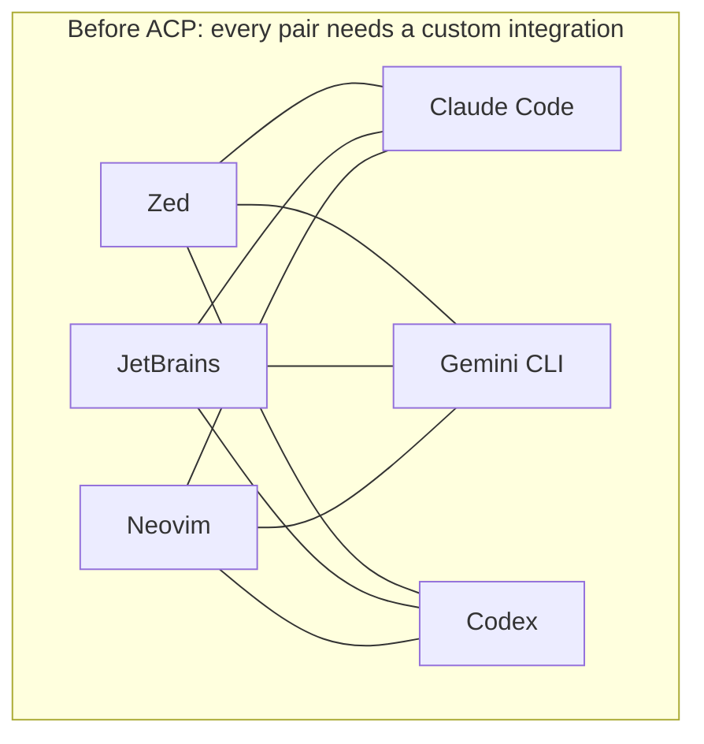
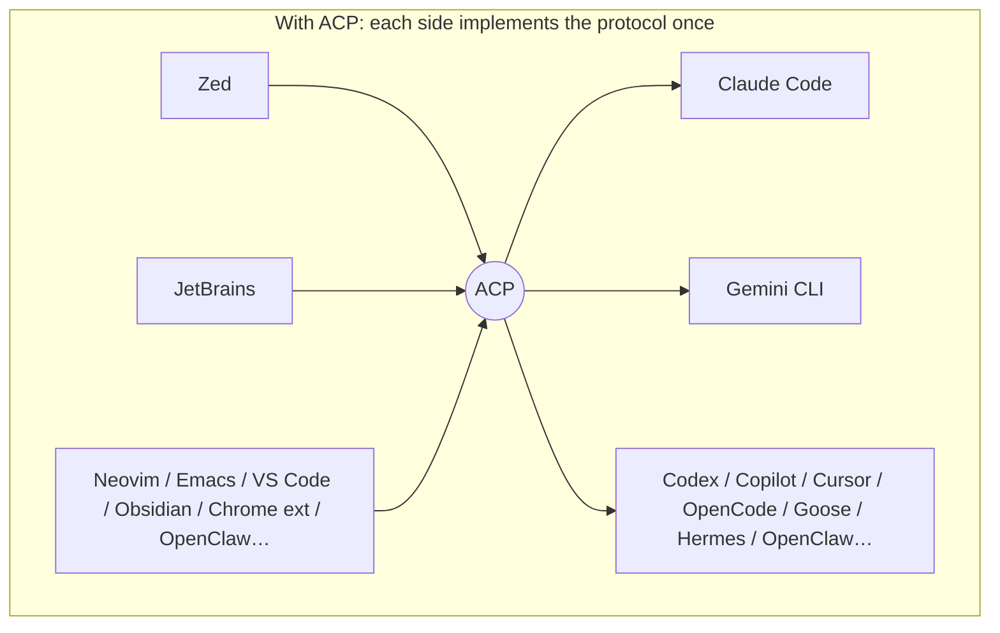
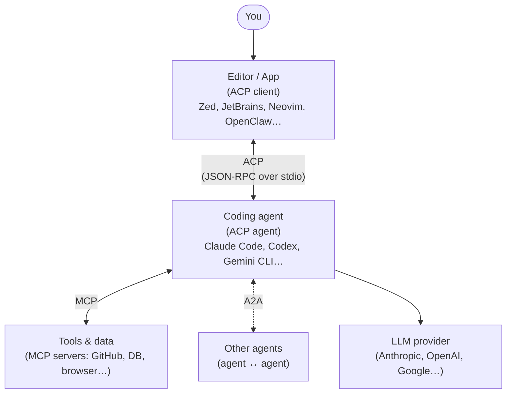
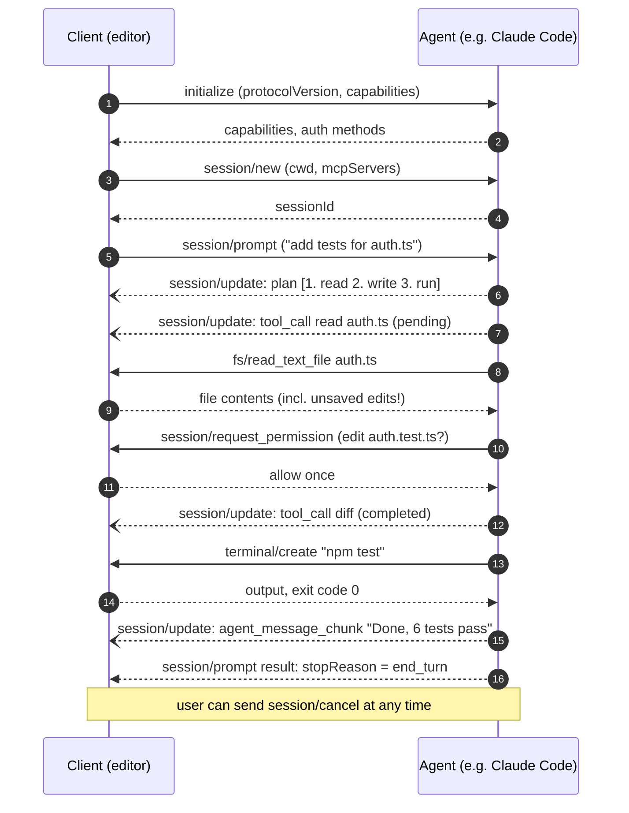
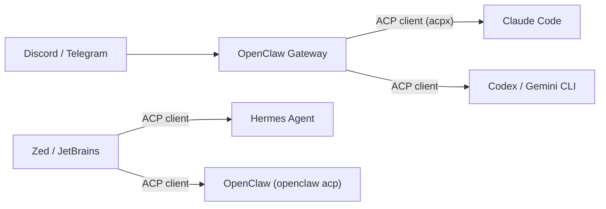

# ACP (Agent Client Protocol) — 101

> Sources: the spec repo `agentclientprotocol/agent-client-protocol` @ `0f1af73` (2026-10-12):
> `docs/get-started/*`, `docs/protocol/v1|v2/*`; Zed and JetBrains registry announcements; OpenClaw and
> Hermes docs (see earlier files). Diagrams are Mermaid and render on GitHub.

## ⚠️ First: which "ACP"?

Three different protocols share the acronym. In AI coding conversations it almost always means #1.

| Acronym | Full name | What it connects | Who |
|---|---|---|---|
| **ACP** ✅ | **Agent Client Protocol** | **An editor or app ↔ a coding agent** | Zed Industries (now its own `agentclientprotocol` org); JetBrains co-maintains the registry |
| ACP | Agent *Communication* Protocol | Agent ↔ agent | IBM / BeeAI. Merged into Google's **A2A** under the Linux Foundation in 2025. |
| ACP | Agentic *Commerce* Protocol | Agent ↔ merchant checkout | OpenAI + Stripe (shopping inside ChatGPT) |

The rest of this file is about the **Agent Client Protocol**.

---

## 1. One-sentence version

**ACP is "LSP for AI agents".** It is one standard way for any editor or app to drive any coding
agent: send prompts, stream back text, plans, tool calls and diffs, and ask the user for
permission. Every agent no longer needs a custom plugin for every editor.

## 2. The problem it solves (N × M → N + M)

The same trick that **LSP** (Language Server Protocol) pulled off for language smarts
(autocomplete, go-to-definition), applied to AI agents.

## 3. Where it fits next to MCP and A2A

| Protocol | Connects | Analogy |
|---|---|---|
| **ACP** | **UI ↔ agent** ("how do I talk to the agent and show what it's doing?") | The agent's **front door** |
| **MCP** | Agent ↔ tools and data ("what can the agent use?") | The agent's **toolbelt** |
| **A2A** | Agent ↔ agent ("how do agents delegate to each other?") | Agents' **phone line** |
| LSP | Editor ↔ language server | ACP's inspiration |

ACP is designed to work **with** MCP: it reuses MCP's JSON types, and the editor passes its
configured MCP servers to the agent when a session starts.

## 4. How it works under the hood

- **Transport:** the editor **launches the agent as a subprocess** and they exchange
  **JSON-RPC 2.0** messages over **stdin/stdout**, one per line. Logs go to stderr.
  Streamable HTTP for remote agents is a draft; custom transports (e.g. WebSocket) are allowed.
- **Two directions:** the editor calls the agent (prompt, cancel), and the agent calls *back*
  (ask permission, read or write a file, run a terminal command).
- **Streaming:** the agent sends `session/update` **notifications** live: message chunks,
  thoughts, plans, tool calls with status, diffs.
- **Many sessions per connection:** you can run several conversations at once.
- **Text format:** Markdown, so the editor doesn't need an HTML renderer.

### A typical prompt turn

### Method cheat sheet (v1, the stable version)

| Direction | Method | Purpose |
|---|---|---|
| Client → Agent | `initialize` | Negotiate version and capabilities |
| | `authenticate` / `logout` | Sign-in if the agent needs it |
| | `session/new`, `session/load`, `session/list` | Start, resume or list conversations |
| | `session/prompt` | Send the user message (text, images, files, resources) |
| | `session/cancel` | Stop the current turn |
| | `session/set_mode`, config options | e.g. "ask" / "code" / "architect" modes, model choice |
| Agent → Client | `session/update` (notification) | Stream text, thoughts, **plan**, **tool calls**, diffs, available slash commands |
| | `session/request_permission` | "Can I run this or edit that?" (allow once/always, reject) |
| | `fs/read_text_file`, `fs/write_text_file` | Use the **editor's** buffers, including unsaved changes |
| | `terminal/create`, `output`, `wait_for_exit`, `kill`, `release` | Run commands in an editor-owned terminal |
| | `elicitation/create` | Ask the user a structured question |

### v1 → v2 (draft, in progress)

- `session/prompt` now just **accepts** the turn. Progress and the final stop reason arrive as
  `state_update` notifications.
- Updates become **upserts by ID** (patch messages, tool calls and plans in place).
- Client-side **file system, terminal and modes APIs are removed**. If the agent needs tools
  from the client, the client provides them as MCP servers.
- Everything is extensible by default. **v1 stays the stable baseline**; implementers support
  both and negotiate per connection.

## 5. Who supports it (Oct 2026)

**Agents (~40+ listed):** Claude Code (via Zed's `claude-agent-acp` adapter), Codex CLI (adapter),
Gemini CLI, GitHub Copilot CLI, Cursor, Cline, Goose, OpenCode, OpenHands, Junie (JetBrains), Kiro,
Kimi, Qwen Code, Mistral Vibe, Factory Droid, Augment, Docker cagent, **Hermes Agent**, **OpenClaw**…

**Clients (editors & apps):** Zed (the origin; ACP was the headline feature of Zed 1.0), JetBrains
IDEs (native since Dec 2025), Neovim (CodeCompanion, avante, agentic.nvim), Emacs (agent-shell),
VS Code (community extensions), Visual Studio, Sublime, Qt Creator, Obsidian, Unity, **Chrome
extensions** (Chrome ACP, ACP Sidebar), many desktop/web workbenches, and **OpenClaw's `acpx`**.

**ACP Registry** (live since Jan 2026): register an agent once and it shows up in every client
that reads the registry (Zed, JetBrains, …).

**SDKs:** TypeScript (`@agentclientprotocol/sdk`), Python, Rust, Kotlin, Java + community libraries.

## 6. How it shows up in tools you've seen

| Tool | ACP role | Example |
|---|---|---|
| **Zed / JetBrains** | Client | Pick "Claude Code" in the agent panel; edits appear as reviewable diffs |
| **OpenClaw** | **Client** (`acpx` drives Claude Code, Codex, Gemini… from Discord or Telegram) **and agent** (`openclaw acp` exposes a Gateway session to an IDE) | `/acp spawn claude --bind here` |
| **Hermes Agent** | Agent (`acp_adapter/`) | Use Hermes as the agent inside Zed, VS Code or JetBrains |
| **Claude Code** | Agent (through an adapter on the Claude Agent SDK) | Runs inside Zed, JetBrains, Neovim, Obsidian… |

## 7. Strengths & limits

**Strengths**
- Switch agents without switching editors, and the reverse.
- The UX is part of the standard: plans, diffs, permission prompts, cancellation, modes and slash
  commands all look the same across tools.
- Simple to implement (JSON-RPC over stdio, the same model as LSP and MCP); official SDKs in 5 languages.
- Editor-aware: in v1 the agent sees **unsaved** buffers and can use the editor's terminal.

**Limits**
- Built around local, coding-first use. Remote/cloud transport is still a draft.
- v2 is a breaking redesign that is still in draft, so expect a period of supporting both versions.
- Several big agents (Claude Code, Codex) speak it through **adapters**, not natively, so features
  can lag behind.
- The name collides with two other "ACP"s, which causes confusion.

## 8. Product-idea angles for this repo

- **Browser extension as an ACP client:** a side panel that talks to a local agent through a
  tiny native-messaging bridge, with "send this tab or selection to Claude Code / Hermes".
  Community examples already exist (Chrome ACP, ACP Sidebar), so the gap is polish and features
  (page context, form filling, multi-agent switching).
- **ACP ↔ chat bridge:** like OpenClaw's `acpx`, but a lightweight standalone tool (Slack or
  Discord ↔ any ACP agent).
- **ACP inspector/debugger:** a proxy that records and visualises the JSON-RPC traffic between
  any client and agent (useful for the v1→v2 migration).

## Sources

- Spec & docs: https://github.com/agentclientprotocol/agent-client-protocol (agentclientprotocol.com)
- Zed — ACP Registry is live: https://zed.dev/blog/acp-registry
- JetBrains — ACP agent registry: https://blog.jetbrains.com/ai/2026/01/acp-agent-registry/
- Explainers: https://www.morphllm.com/agent-client-protocol, https://agentic-ai.readthedocs.io/en/latest/Standards/agent-client-protocol/
