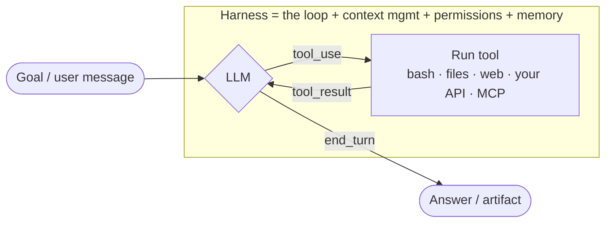
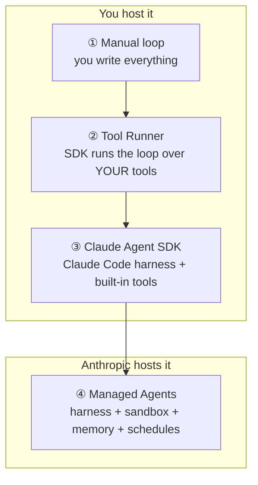
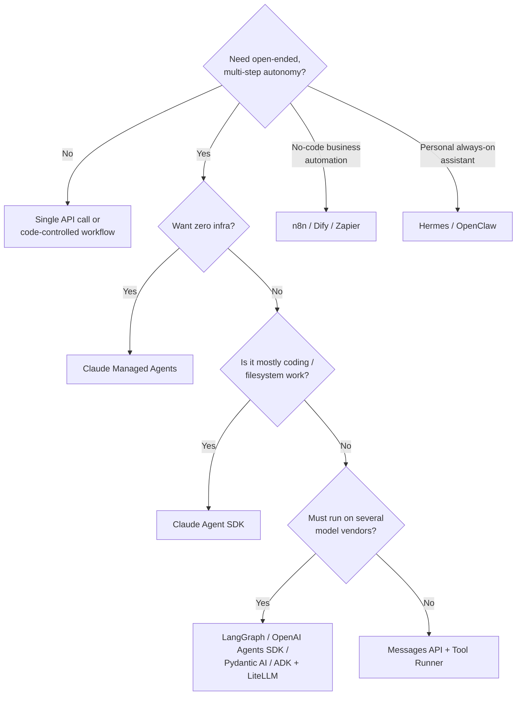

# Agent Building — 101 (Claude-native vs third-party)

> Sources: Anthropic's bundled `claude-api` skill reference (models cached 2026-10-06), Claude Code docs
> (code.claude.com), and earlier research files in this repo (Hermes, OpenClaw, ACP). Third-party
> framework details are from general knowledge; check current docs before you build on them.

## 0. What an "agent" actually is

An agent is **an LLM in a loop with tools**. The model decides on the next action, your code (or
someone's harness) runs the tool, and the result is fed back. This repeats until the model says
it's done.



Everything below is a different answer to two questions (the framing Anthropic's own reference uses):

1. **Who writes the harness?** (loop, context management, retries, permissions)
2. **Who hosts and deploys it?** (where the loop and the tools actually run)

**Before you build an agent, check:** Is the task multi-step and hard to specify up front? Is
the result worth the extra cost and latency? Can Claude do this kind of task? Can mistakes be
caught (tests, review, rollback)? If any answer is no, use a **single API call** or a **fixed
workflow** you control in code instead.

---

## 1. Claude's native ways to build agents

### The ladder (least → most done for you)

| # | Approach | You write | Harness | Hosting | Built-in tools | Best for |
|---|---|---|---|---|---|---|
| 1 | **Messages API, manual loop** | The `while stop_reason == "tool_use"` loop | You | You | None (plus optional *server tools*: web search/fetch, code execution) | Full control, no beta dependencies |
| 2 | **Tool Runner** (`client.beta.messages.tool_runner`) | Tool functions only | SDK | You | None, only your tools | Most custom-tool agents; still has per-turn hooks for approvals and logging |
| 3 | **Claude Agent SDK** (`claude-agent-sdk` / `@anthropic-ai/claude-agent-sdk`) | A prompt + options | **Claude Code's harness** | You | Read/Write/Edit/Bash/Grep/Glob/WebSearch/WebFetch, MCP, subagents, hooks, permissions, sessions | A coding or filesystem agent on your own infra ("Claude Code as a library") |
| 4 | **Managed Agents** (REST, beta) | Agent config + your tool results | **Anthropic** | **Anthropic** (one container per session, or your own sandbox) | Bash, files, code exec + Skills + MCP + your tools | Hosted, long-running, versioned, scheduled or multi-agent work with no servers to run |



> **Common mix-up:** the **Tool Runner** and the **Claude Agent SDK** are different packages. The
> Tool Runner is a small helper inside the normal `anthropic` SDK that loops over tools *you*
> define. The Agent SDK is Claude Code packaged as a library, with its own built-in tools.

### ① / ② Messages API + Tool Runner (Python sketch)

```python
import anthropic
from anthropic import beta_tool

client = anthropic.Anthropic()

@beta_tool
def lookup_order(order_id: str) -> str:
    """Look up an order's status.

    Args:
        order_id: The order ID, e.g. A-1234.
    """
    return f"Order {order_id}: shipped"

runner = client.beta.messages.tool_runner(
    model="claude-opus-5-5",
    max_tokens=16000,
    tools=[lookup_order],
    messages=[{"role": "user", "content": "Where is order A-1234?"}],
)
for message in runner:          # the SDK calls the tool and loops until Claude is done
    print(message)
```

Building blocks you add on top: **server tools** (web search/fetch, code execution, tool search)
that Anthropic runs, **MCP connector** for remote MCP servers, **structured outputs**, **prompt
caching**, **compaction** / **context editing** for long runs, a **memory tool**
(`memory_20250818`), **Agent Skills** (packaged instructions and scripts), **task budgets**, and
**adaptive thinking + effort** to control how deeply the model thinks.

### ③ Claude Agent SDK

You call `query(prompt, options)` and get the full Claude Code agent: the same tools, permission
modes, hooks, subagents, MCP servers, skills, `CLAUDE.md` / project memory and session resume.
You host it (a server, CI, a container). Docs: https://code.claude.com/docs/en/agent-sdk

### ④ Managed Agents (beta)

- **Agent** (created once, versioned: model, system prompt, tools, MCP, skills) →
  **Session** (every run, pinned to a version, gets its own container workspace) →
  **events** you stream over SSE.
- Extras: **vaults** (secrets are inserted when requests leave the sandbox, so the agent never
  sees them), **memory stores**, **outcomes** (a separate grader re-runs the work against your
  rubric until it passes), **multi-agent** (a coordinator with worker agents, or "dynamic
  workflows" for very large fan-out), **scheduled deployments** (cron), **permission policies**
  (`always_allow` / `always_ask` / `auto`), webhooks, hard **dollar budgets** per session,
  **self-hosted sandboxes** if tools must run in your own network.
- Config as code: keep agents and environments in files and sync them with `ant apply`.

### No-code / low-code ways to build agents in Claude's own products

| Where | Building block | What it gives you |
|---|---|---|
| **Claude Code** | `CLAUDE.md` / rules | Standing instructions (see `openclaw-vs-claude-code-memory.md`) |
| | **Subagents** (`.claude/agents/*.md`) | Named specialists with their own prompt, tools, model and (optional) memory |
| | **Skills** (`SKILL.md` folders) | Procedures loaded only when relevant; the agentskills.io format is shared with Hermes and OpenClaw |
| | **Hooks** | Rules that always run at fixed points (before or after a tool call, on prompt submit…) |
| | **Plugins / slash commands / MCP servers** | Bundle and share all of the above |
| | `/loop`, routines, background sessions | Recurring or unattended agent runs |
| **Claude apps (claude.ai / Desktop / Cowork)** | Projects + connectors (MCP) + skills | Personal agents without code (e.g. "triage my inbox every morning") |
| **Agent Skills via API** | `container.skills` + code execution | Reuse the same skills from your own app |

---

## 2. Third-party ways to build agents

### A. Code frameworks (you write the agent; most support Claude via its SDK)

| Framework | Language | Style | Notable for |
|---|---|---|---|
| **LangGraph** (LangChain) | Py / TS | Graph / state machine | Explicit control flow, checkpoints, human-in-the-loop, LangSmith tracing |
| **CrewAI** | Py | Role-based "crew" of agents | Fast multi-agent prototypes (researcher → writer → reviewer) |
| **OpenAI Agents SDK** | Py / TS | Agents + handoffs + guardrails | Lightweight; works with other providers via LiteLLM |
| **Google ADK** | Py / Java | Hierarchical agents | Gemini/Vertex-first, A2A-native, runs other models |
| **Microsoft Agent Framework** (AutoGen + Semantic Kernel) | Py / .NET | Multi-agent conversations & workflows | Enterprise/.NET shops, Azure |
| **Pydantic AI** | Py | Typed agents | Type-safe tools and outputs, very "Pythonic" |
| **Mastra** / **Vercel AI SDK** | TS | Agents + workflows in web apps | Next.js / Node teams, streaming UIs |
| **LlamaIndex** | Py / TS | Agents over your data | RAG-heavy agents, document workflows |
| **Strands Agents** (AWS) / **smolagents** (HF) | Py | Minimal model-driven loop / code-writing agents | Simplicity; Bedrock or open models |

### B. Visual / no-code builders

**n8n, Dify, Flowise, Langflow, Make, Zapier Agents, Relevance AI, Lindy.** You drag and drop
triggers, an "AI Agent" node, tools and memory. They are strongest at **integrations** and
**business workflows**, and weaker for open-ended autonomy. All support Claude.

### C. "Agent you configure" platforms (from our earlier research)

| Platform | How you "build" an agent |
|---|---|
| **Hermes Agent** | Profiles (persona + memory + skills), skills, plugins, cron, `/goal`, Kanban workers, `delegate_task`; can hand work to Claude Code |
| **OpenClaw** | Agents in `openclaw.json`, workspace files (`AGENTS.md`, `SOUL.md`), **standing orders**, skills (ClawHub), plugins, sub-agents / Swarm, **ACP** to drive Claude Code, Codex and others |
| **Letta** | Stateful agents built around memory, with an agent development environment (ADE) |
| **Goose / OpenHands** | Recipes / MCP extensions; coding-agent platforms |

### D. The standards that connect everything

| Standard | Role in agent building |
|---|---|
| **MCP** | Give *any* agent tools and data (write once, use in Claude, Hermes, OpenClaw, n8n…) |
| **Agent Skills** (agentskills.io) | Share *procedures* across Claude, Hermes, OpenClaw… |
| **ACP** | Put your agent inside *any editor or app* (see `acp-agent-client-protocol-101.md`) |
| **A2A** | Agent ↔ agent delegation across vendors |

### E. Supporting tools: observability & evals

LangSmith, Langfuse, Braintrust, Arize Phoenix, Weights & Biases Weave, plus OpenTelemetry. You
need these once an agent runs unattended.

---

## 3. Native vs third-party: how to choose



| | Claude-native | Third-party |
|---|---|---|
| **Pros** | Newest model features first (thinking, caching, compaction, server tools, skills); Claude Code-quality harness; managed hosting option; fewer moving parts | Multi-vendor; graph-level control (LangGraph); visual building (n8n); large integration catalogs; vendor-neutral observability |
| **Cons** | Built around Claude (Agent SDK and Managed Agents are Claude-only); Managed Agents is beta | Abstraction layers lag new API features and can break prompt caching; more dependencies; you still host it |
| **Lock-in hedge** | Put tools behind **MCP** and procedures in **Skills**, so either path can reuse them | Same |

## 4. Suggested learning path

1. Make one tool-use call with the Messages API so you see the raw loop.
2. Switch to the **Tool Runner** and add 2–3 real tools plus prompt caching.
3. Try the **Claude Agent SDK** for a coding or filesystem task.
4. Try **Managed Agents** for something hosted or scheduled (`/claude-api managed-agents-onboard`).
5. Build the same agent in **LangGraph** or **n8n** to feel the trade-offs.
6. Package your tools as an **MCP server** and your procedures as a **Skill**, and reuse them
   in Claude Code, Hermes or OpenClaw.

## 5. Product-idea angles for this repo

- **"Agent from a browser tab" extension:** record a web workflow and export it as a Skill plus an
  MCP tool definition that Claude, Hermes or OpenClaw can run.
- **Cross-framework agent scaffolder:** one spec (`agent.yaml`) → generates a Tool Runner,
  Agent SDK, Managed Agents (`ant apply`) or LangGraph version.
- **Agent run viewer:** a visual trace of tool calls, cost and permissions across Claude
  Managed Agents, the Agent SDK and OpenClaw/Hermes sessions.
